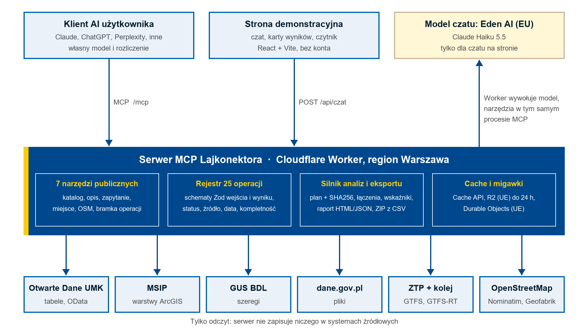

<p align="center"></p>

# Lajkonektor

**Otwarte dane Krakowa w każdym narzędziu AI.** Lajkonektor to publiczny serwer [Model Context Protocol](https://modelcontextprotocol.io) (MCP), który udostępnia modelom AI dane Urzędu Miasta Krakowa, MSIP, GUS, dane.gov.pl, ZTP i OpenStreetMap. Model rozumie pytanie i dobiera narzędzie, a serwer pobiera dane i liczy wynik. Każda odpowiedź ma źródło, czas pobrania, kompletność i ograniczenia.

- **Demo z czatem:** <https://lajkonektor.sendyka.workers.dev>
- **Adres MCP:** `https://lajkonektor.sendyka.workers.dev/mcp` (publiczny, tylko odczyt, bez logowania)
- **Dokumentacja techniczna:** [docs/dokumentacja-techniczna.md](docs/dokumentacja-techniczna.md)

> Projekt niezależny zespołu JAK, przygotowany na konkurs Open Data Kraków 2026. Nie jest serwisem Miasta Krakowa.

## Co potrafi

| Obszar | Przykładowe pytanie |
|---|---|
| Katalog danych | „Jakie dane o hałasie ma Kraków? Pokaż pięć zbiorów i co zawierają.” |
| Zapytania i agregacje | „Które dzielnice mają największą powierzchnię parków miejskich?” |
| Transport na żywo | „Kiedy najbliższy tramwaj spod Teatru Słowackiego?” |
| Okolica | „Znajdź apteki w promieniu 800 metrów od placu Centralnego.” |
| Planowanie | „Jakie informacje planistyczne są dostępne dla adresu Telimeny 11?” |
| Analizy dzielnic | „W których dzielnicach jest najmniej szkół podstawowych na dzieci w wieku 7–14 lat?” |
| Statystyka i prognozy | „Jak zmieniała się stopa bezrobocia w Krakowie i co pokazuje prognoza?” |
| Raporty i eksport | Plan analizy do zatwierdzenia (SHA256), raport HTML/JSON, ZIP z tabelami CSV |

Liczby, filtry, wskaźniki i projekcje oblicza kod, nie model. Wynik częściowy jest oznaczony i nie jest przedstawiany jako wartość dla całego miasta.

## Podłączenie do własnego AI

Dodaj zdalny serwer MCP z adresem `https://lajkonektor.sendyka.workers.dev/mcp`, bez uwierzytelniania:

- **Claude:** Customize → Connectors → Add → Custom → Web, nazwa „Lajkonektor”, wklej adres, No sign in.
- **ChatGPT, Perplexity i inne:** w ustawieniach konektorów dodaj własny serwer MCP z tym adresem.

Klient zobaczy siedem narzędzi: `katalog_szukaj`, `zbior_opis`, `dane_zapytaj`, `miejsce_szukaj`, `osm_obiekty`, `operacje_szukaj`, `operacja_wykonaj`. Ostatnie dwa dają dostęp do pozostałych operacji: transportu, analiz, GUS BDL, dane.gov.pl, wizualizacji i eksportu. Klienty obsługujące MCP Apps wyświetlają karty z tabelami, mapami i wykresami.

## Uruchomienie lokalne

Wymagania: Git, Node.js 24 lub nowszy (sprawdzono na 24.15.0), npm.

```bash
git clone https://github.com/asterixix/lajkonektor.git
cd lajkonektor/server
npm ci
npm test        # testy offline; testy na żywo: NA_ZYWO=1 npm test
npm run dev     # lokalny Worker (Wrangler); adres i port wypisuje terminal
```

Serwer MCP działa pod ścieżką `/mcp`, strona pod `/`. Odczyt danych nie wymaga klucza. Czat na stronie wymaga klucza Eden AI w `server/.dev.vars` (wzór: [`.dev.vars.example`](server/.dev.vars.example)); bez niego strona działa, a czat pokazuje komunikat o niedostępności.

Inne polecenia (z `server/`): `npm run typecheck`, `npm run build:site`, `npm run build:ui`, `npm run deploy`. Szczegóły dla współpracowników i agentów kodujących: [AGENTS.md](AGENTS.md).

## Architektura



- **Cloudflare Workers** (region Warszawa), TypeScript, walidacja **Zod**, **MCP Server** i **MCP Apps**.
- Strona: **React** + **Vite**; karty wyników wspólne dla klienta MCP i strony.
- Durable Objects i R2 w jurysdykcji UE: koordynacja geokodowania, budżet czatu, awaryjne migawki do 24 h.
- Czat demo: model przez Eden AI (endpoint EU). Zewnętrzny klient MCP używa własnego modelu.

```
server/
  src/      Worker, rejestr operacji, źródła, transport, analizy, czat
  shared/   kontrakt raportu i eksport (serwer + przeglądarka)
  ui/       karty wyników MCP Apps
  site/     strona demonstracyjna
  data/     katalog zbiorów i migawki analityczne
  test/     testy offline, na żywo i zestaw ewaluacyjny
brand/      znak i tokeny kolorów
docs/       dokumentacja techniczna i produktowa
```

## Źródła danych

| Źródło | Zakres |
|---|---|
| [Otwarte Dane Krakowa](https://otwartedane.um.krakow.pl/) | Tabele miejskie (OData) |
| [MSIP Kraków](https://msip.krakow.pl/) | Warstwy ArcGIS: demografia, edukacja, zdrowie, planowanie, działki |
| [GUS Bank Danych Lokalnych](https://bdl.stat.gov.pl/) | Szeregi statystyczne |
| [dane.gov.pl](https://dane.gov.pl/) | Zbiory i pliki krajowe |
| [ZTP Kraków](https://gtfs.ztp.krakow.pl/) | GTFS i GTFS-RT |
| Rozkłady PKP PLK ([mkuran.pl](https://mkuran.pl/gtfs/)) | Rozkład kolejowy, bez opóźnień |
| [OpenStreetMap](https://www.openstreetmap.org/) | Nominatim, migawka obiektów z ekstraktu Geofabrik, kafelki |

Katalog w `server/data/katalog.json` obejmuje 1203 pozycje (migawka z 19.10.2026). Dane pozostają własnością ich wydawców i podlegają ich warunkom; licencja MIT obejmuje kod projektu.

## Ograniczenia

Ludność w danych MSIP to osoby zameldowane na pobyt stały. Liczba miejsc w rejestrze nie oznacza wolnych miejsc. Dojazd to szacunek z najwyżej jedną przesiadką, kolej pokazuje rozkład bez opóźnień. Zestawienie planistyczne nie zastępuje wypisu z planu, a prognoza jest projekcją trendu. Odpowiedź AI wymaga sprawdzenia; wynik zawsze wskazuje źródło, które można skontrolować.

## Licencja i atrybucje

Kod: [MIT](LICENSE). Dane mapowe: © współtwórcy OpenStreetMap, [ODbL](https://www.openstreetmap.org/copyright). Czcionka Lato: SIL Open Font License ([tekst](server/ui/fonts/OFL.txt)). Tło strony: mapa dzielnic Krakowa, autor Slawojar, Wikimedia Commons, CC BY-SA 3.0, zmienione kolory.

## Zespół JAK

Artur Sendyka (technologia i biznes), Jakub Deszcz (konsultacje, testy i prezentacja). Kontakt: artur@sendyka.dev.
