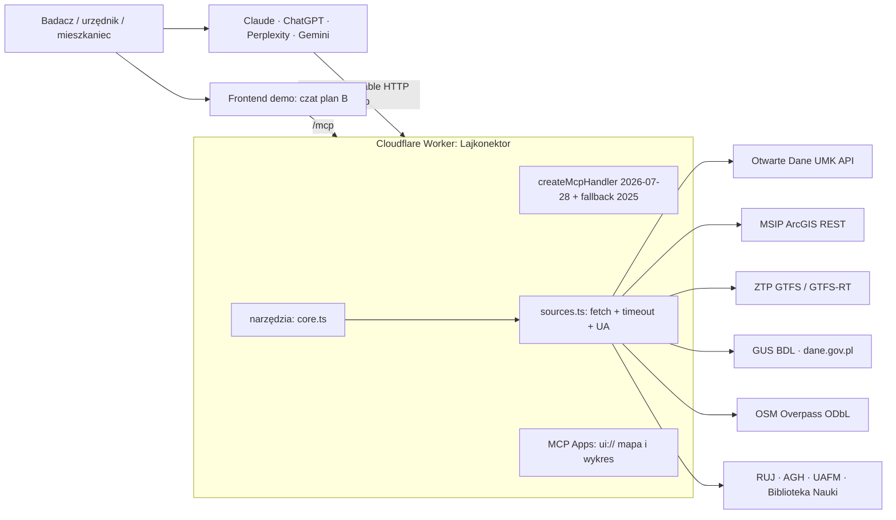

# Architektura Lajkonektora

**Data:** 2026-10-19 · **Faza:** 6 (Produkt) · **Pewność:** wysoka dla tego, co uruchomiono (szkielet + 4 testy na żywych API), niska dla MCP Apps, Tasks, Skills i klientów (Claude Pro) — jeszcze niesprawdzone.

## Zasady (cięcie zakresu)
1. **Tylko odczyt, bez logowania.** Dane są otwarte, więc OAuth nie jest potrzebny (stary `polish-academic-mcp` miał limity 100/mies. i konta; tu to odpada).
2. **Użytkownik płaci za własny model** (BYO-LLM): serwer nie wywołuje LLM. Koszt stały miasta ≈ hosting.
3. **Bezstanowy handler fetch** — działa na Cloudflare Workers, a ten sam kod uruchomi się w Deno/Bun/Node (przenośność do hostingu miejskiego).
4. **Mało narzędzi (cel ≤ 10)**, każde z jasnym opisem. Każdy wynik niesie `zrodlo`, `uwaga` i datę danych (zaufanie do liczb to kryterium jury).
5. **Liczby liczy kod, nie model.** Wskaźniki (zasięg, sumy) liczone deterministycznie w narzędziach; model tylko je opisuje.

## Schemat

## Komponenty (stan na 19.10)

| Plik | Rola | Stan |
|---|---|---|
| `server/src/index.ts` | Worker: `/mcp` (handler), `/health`, CORS otwarty | działa lokalnie (`wrangler dev`) |
| `server/src/server.ts` | rejestracja narzędzi (zod, adnotacje readOnly/idempotent), wspólne `run()` → tekst JSON + `structuredContent` lub `isError` | działa |
| `server/src/core.ts` | logika narzędzi bez SDK (testowalna) | 3 narzędzia gotowe |
| `server/src/sources.ts` | `arcgisQuery` (sprawdza błędy w HTTP 200), `odGet`, timeout 25 s, User-Agent | działa |
| `server/test/core.test.ts` | testy integracyjne na żywych API | 4/4 przechodzą |

SDK: `@modelcontextprotocol/server` 2.3.1 (`createMcpHandler` obsługuje rewizję 2026-07-28 i bezstanowy fallback dla ruchu z 2025), `@modelcontextprotocol/ext-apps` 2.0.3 (MCP Apps), `zod` 4. [Data: README i typy pakietów]

## Narzędzia

> **Aktualizacja 19.10 wieczór:** lista poniżej jest przestarzała. Zastąpiła ją architektura uniwersalna: katalog + `dane_zapytaj` + BDL + dane.gov.pl, patrz `narzedzia-uniwersalne.md`.

**Gotowe (5):**
- `parki_lista` — parki miejskie/kieszonkowe z OD (78 rekordów; bez geometrii).
- `mpzp_w_punkcie` — przeznaczenia MPZP w punkcie (MSIP `Planowanie/BP_MPZP`, warstwy 1–3, wejście WGS84).
- `ludnosc_w_promieniu` — zameldowani w promieniu z siatki Hex100, najnowszy snapshot (dziś 2026-09-30).
- `adres_na_punkt` — geokodowanie przez punkty adresowe MSIP; działa też bez polskich liter (wieloznacznik `_`). Sprawdzone: Telimeny 11, Basztowa 20, Łojasiewicza 4.
- `parki_geometria` — migawka OSM (`server/data/parki-osm.json`, skrypt `scripts/build-parki-osm.mjs`) dopasowana do tabeli OD. **Pokrycie: 46 z 78 parków (44,9% powierzchni OD)**: 32 bez geometrii (23 nie znaleziono po nazwie, 8 bez domkniętego poligonu, 1 — Planty Bieńczyckie — z konturem OSM należącym do innego parku), 2 z rozbieżną powierzchnią (>2x). Pole `pokrycie` jest w każdej odpowiedzi.

**Następne (kolejność z planu):**
3. `park_dostepnosc` — udział zameldowanych w zasięgu 300/500 m od parku, per dzielnica (liczone w kodzie).
4. `mpzp_zielen_bez_parku` — poligony `ZP…` minus istniejące parki = „potencjał" (jawnie: teren przeznaczony pod zieleń).
5. `badania_szukaj` — literatura z RUJ/AGH/UAFM/BN (wzorzec z `polish-academic-mcp`, tylko potrzebne wywołania).
6. `plik_odczyt` — CSV/XLSX/PDF/GeoJSON z URL (whitelist hostów miejskich i GUS), zwraca tabelę.
7. `bdl_szereg` — szeregi GUS; `ztp_pojazdy`/`ztp_trasa` — GTFS + GTFS-RT (live).
8. `eksport` — CSV/XLSX z wyniku i bibliografia (dla badacza).

## Extensions MCP (kolejność ważności)
- **MCP Apps:** narzędzie z `_meta.ui.resourceUri` + zasób `ui://…` (HTML z mapą i wykresem). Zawsze `content` tekstowy jako fallback dla klientów bez UI. Wymagane: sprawdzić, że Claude Pro renderuje.
- **Skills over MCP:** jeden skill „Badacz miejski" (jak formułować zapytanie, cytować, opisywać niepewność). Najtańszy, duży efekt dla innowacyjności.
- **Tasks:** jedna długa analiza (audyt parków 18 dzielnic). Tylko jeśli zostanie czas.

## Pułapki z danych (wpływają na projekt)
- Hex100 ma **kwartalne snapshoty 2008-12-31 … 2026-09-30** [Data], więc możliwe trendy (np. zmiana liczby zameldowanych), ale to zameldowania, nie faktyczna ludność. Statystyka `max` po całej warstwie wywala serwer; używamy sortowania z limitem 1 (naprawione w teście).
- Warstwy MPZP 1–3 to skale tej samej treści; zbieramy z wszystkich i deduplikujemy.
- ArcGIS zwraca błędy w HTTP 200; `arcgisQuery` to sprawdza.
- OD API nie przyjmuje `$top`; filtrowanie po stronie serwera Lajkonektora.
- Overpass wymaga nagłówka User-Agent (inaczej 406) i bywa przeciążony (502), więc geometria to migawka budowana raz, nie zapytanie w czasie działania.
- 🔴 Luka pokrycia: 55% powierzchni parków OD bez geometrii. W pitchu mówić „46 z 78 parków z geometrią" albo uzupełnić brakujące z MPZP (ZP) lub od jednostki miejskiej.

## Bezpieczeństwo i prywatność
- Tylko odczyt, brak PII, adresy użytkownika nie są zapisywane ani logowane (Worker nie loguje argumentów).
- Wyniki z API traktowane jako dane (ochrona przed wstrzykiwaniem treści z pól tekstowych): zwracamy je jako JSON, bez instrukcji.
- `plik_odczyt`: tylko dozwolone hosty, limit rozmiaru i czasu (ochrona przed SSRF).
- Limity: Cloudflare Rate Limiting na `/mcp`; ostrzeżenie o niskich limitach darmowego planu Workers (CPU na parsowanie XLSX/SHP) [Knowledge-Based, zweryfikować cennik].

## Wdrożenie i koszt
- `wrangler deploy` → `*.workers.dev`; później własna domena (`lajkonektor.dev` jest wolna, patrz PROGRESS).
- Docelowo: ten sam handler na infrastrukturze miejskiej (Deno/Node) po umowie z UM.
- Koszt: hosting rzędu 0–5 USD/mies. + domena ~8 USD/rok [Estimate]; LLM po stronie użytkownika.

## Nieprzetestowane (ryzyka)
- 🔴 Dodanie własnego konektora w **Claude Pro** (wymaga publicznego URL HTTPS; test przez `wrangler deploy` lub `cloudflared`) oraz renderowanie MCP Apps.
- 🟡 Ścieżka „modern" protokołu 2026-07-28 (przetestowano zapytania legacy 2025: `initialize`, `tools/list`, `tools/call`).
- 🟡 Wydajność narzędzi dla całego miasta (dzielnice × parki = wiele zapytań ArcGIS; potrzebny cache i limit współbieżności).
