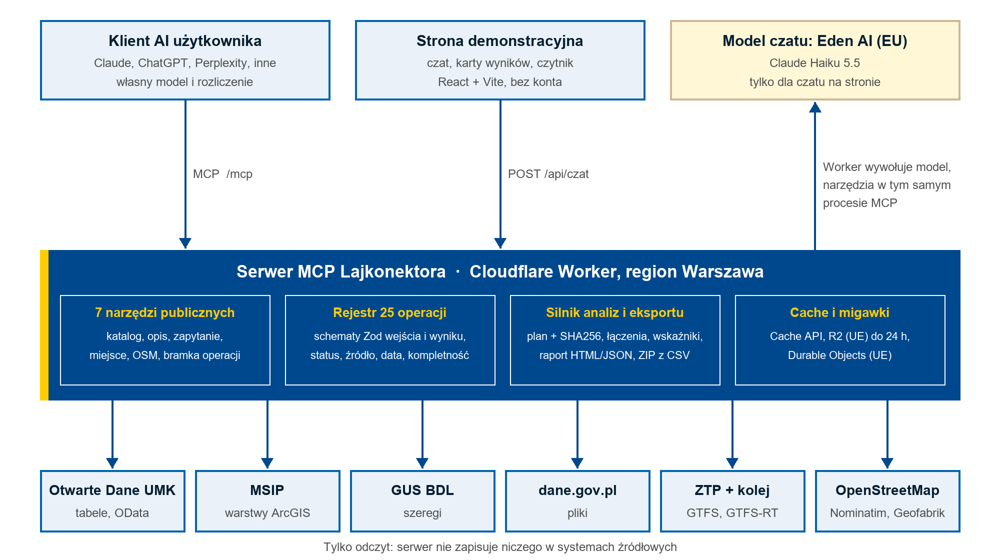

# Lajkonektor. Dokumentacja techniczna

Stan: 1 listopada 2026 roku · Wersja aplikacji: 0.4.0 · Licencja kodu: MIT

Lajkonektor jest publicznym serwerem Model Context Protocol (MCP), który udostępnia otwarte dane Krakowa modelom AI do wyszukiwania, odczytu i obliczeń. Składa się z trzech części: serwera MCP z rejestrem operacji, wspólnych kart wyników MCP Apps oraz strony demonstracyjnej z czatem. Serwer wyłącznie odczytuje systemy źródłowe. Dokument opisuje technologie (rozdział 1), dane (rozdział 2), architekturę (rozdział 3) i możliwości rozwoju (rozdział 4).

## 1. Technologie

### 1.1. Zestaw technologiczny

| Warstwa | Technologia | Zadanie |
|---|---|---|
| Środowisko wykonawcze | Cloudflare Workers, tryb `nodejs_compat` | Serwer HTTP i MCP, przypięty do regionu GCP Warszawa |
| Język | TypeScript 5.9.3, moduły ESM | Cały kod serwera, kart i strony |
| Protokół | MCP Server 2.3.1, Streamable HTTP | Publiczne narzędzia dla klientów AI |
| Karty wyników | MCP Apps 2.0.3 | Tabele, mapy, wykresy, odjazdy i raporty w kliencie AI |
| Walidacja | Zod 4.6.7 | Schematy wejścia i wyniku każdej operacji |
| Strona demo | React 18.3.1, Vite 5.4.21, Motion 11.18.2 | Strona, czat i czytnik raportów |
| Renderowanie odpowiedzi | markdown-it 14.3.3 | Markdown bez surowego HTML i obrazów |
| Archiwa | fflate 0.8.3 | Strumieniowe indeksowanie GTFS, pakiety ZIP raportów i danych |
| Magazyny | Durable Objects, R2 (jurysdykcja `eu`), Cache API | Koordynacja geokodowania, budżet czatu, migawki awaryjne, cache |
| Model czatu demo | Claude Haiku 5.5 przez Eden AI, endpoint EU | Wyłącznie czat na stronie; zewnętrzny klient używa własnego modelu |
| Narzędzia | Wrangler 4.151.2, Node.js 24, `node --test` | Lokalny serwer, wdrożenie, testy |

Wersje pochodzą z `server/package-lock.json`. Testy i skrypty uruchamia Node.js bezpośrednio na plikach `.ts`, bez osobnej kompilacji.

### 1.2. Uzasadnienie wyboru

**MCP** oddziela dostęp do danych od aplikacji AI. Jedna implementacja obsługuje Claude, ChatGPT, Perplexity i inne zgodne klienty. Miasto nie musi utrzymywać integracji z każdym dostawcą osobno.

**Cloudflare Workers** zapewnia brak stałego serwera do administrowania, rozliczenie według użycia i skalowanie bez konfiguracji. Przypięcie do regionu Warszawy (`placement.region: gcp:europe-central2`) rozwiązało problem zrywania połączeń przez serwery Urzędu Miasta Krakowa z zapytaniami spoza regionu, które kończyły się błędem HTTP 522.

**Zod** pełni dwie funkcje. Waliduje argumenty od modelu przed wykonaniem operacji i generuje schematy, z których model odczytuje polskie opisy parametrów.

**MCP Apps** pozwala pokazać wynik jako interaktywną kartę w kliencie AI. Te same renderery działają na stronie demonstracyjnej przez mostek w Shadow DOM, więc wygląd wyników jest jednolity w obu miejscach.

## 2. Dane

### 2.1. Źródła

| Źródło | Zakres | Sposób dostępu |
|---|---|---|
| Otwarte Dane UMK (`api.um.krakow.pl`) | Tabele miejskie | Filtry OData, kursor stron, agregacje po stronie serwera |
| MSIP (`msip3.um.krakow.pl`) | Warstwy ArcGIS: demografia, edukacja, zdrowie, planowanie, działki, środowisko | SQL `where`, wybór pól, geometria, stronicowanie `offset` |
| GUS Bank Danych Lokalnych | Zmienne statystyczne dla jednostek terytorialnych | Wyszukiwanie zmiennych, szeregi czasowe |
| dane.gov.pl | Zbiory i zasoby krajowe | Wyszukiwanie, odczyt plików CSV, XLSX, JSON, GeoJSON |
| ZTP Kraków | Rozkład GTFS, pozycje pojazdów i komunikaty GTFS-RT | Indeks sieci co 30 minut, odczyt realtime przy zapytaniu |
| Rozkłady PKP PLK (agregat `mkuran.pl`) | Rozkład kolejowy | GTFS, bez danych o opóźnieniach |
| OpenStreetMap | Geokodowanie, obiekty w okolicy, podkład mapy | Nominatim, migawka obiektów z ekstraktu Geofabrik (10 kategorii, promień do 5 km), kafelki |

Katalog wdrożeniowy (`server/data/katalog.json`) obejmuje 1203 pozycje Otwartych Danych UMK i MSIP według migawki z 19 października 2026 roku. Pozycja oznacza tabelę lub warstwę. Liczba pozycji nie jest liczbą niezależnych tematów. Świeżość katalogu i świeżość odczytywanych danych to dwie różne właściwości: katalog jest migawką, a dane są pobierane w chwili zapytania.

Wdrożenie zawiera także migawki analityczne: granice 18 dzielnic, ludność dzielnic według grup wieku oraz siatkę heksagonalną 100 m (stan 30 września 2026 roku). Ludność w danych MSIP oznacza osoby zameldowane na pobyt stały. Geometrie parków z OpenStreetMap mają częściowe pokrycie, a wynik zawsze podaje jego zakres.

### 2.2. Łączenie źródeł

Operacja `analiza` łączy do 8 źródeł i 12 operacji w jednym planie. Może zestawić rejestry MSIP, tabele UMK, szeregi GUS, pliki z dane.gov.pl i lokalne migawki dzielnic. Łączenie tabel wymaga jawnych kluczy i deklarowanej kardynalności. Silnik sprawdza zgodność jednostek, dat i poziomów terytorialnych; rozbieżność pozostaje w wyniku jako ostrzeżenie.

Próba z 25 października 2026 roku, wykonana na rzeczywistych API bez modelu językowego, połączyła 8 źródeł w 20 tabel:

| Źródło próby | Zakres |
|---|---|
| MSIP `Demografia/Elud_Dz` | 18 dzielnic, grupy wieku 0–2 i 3–6 lat, stan 30.09.2026 |
| MSIP `Zdrowie/Zlobki_Kluby_rodzicow`, warstwy 0–2 | 35 żłobków publicznych, 323 niepubliczne, 51 klubów rodzica |
| MSIP `Edukacja/EK_PLACOWKI/1` | 469 placówek przedszkolnych |
| GUS BDL, zmienne 59, 68, 1365234 | Urodzenia żywe, przyrost naturalny, saldo migracji; gmina Kraków, 2020–2025 |

Żłobki publiczne i kluby przypisano do dzielnic według geometrii. Rekordy bez rozpoznanej dzielnicy (odpowiednio 2 i 3) oraz 4 konflikty opisu z geometrią pozostały jawne w wyniku. W rejestrze niepublicznym 15 rekordów nie otrzymało dzielnicy z powodu brakujących lub sprzecznych etykiet. Rachunek kontrolny dla Starego Miasta: 52 miejsca w żłobkach publicznych / 326 dzieci w wieku 0–2 lata × 1000 = 159,51. Wskaźnik zestawia wielkości rejestrowe i nie mierzy wolnych miejsc ani popytu. Dane GUS dotyczą całej gminy i nie są rozdzielane między dzielnice.

### 2.3. Daty, kompletność i ograniczenia

Każdy wynik zawiera `_dowod.pobrano`, czyli czas wykonania odczytu. Nie jest to data stanu danych. Datę stanu podaje się tylko wtedy, gdy wskazuje ją źródło. Narzędzia katalogowe dodają datę migawki katalogu.

Pole `kompletne=false` oznacza wynik częściowy i blokuje przedstawienie sumy jako wartości dla całego miasta. Zero rekordów może wynikać z filtra, słownika lub zakresu źródła, więc nie dowodzi braku zjawiska. Kod obsługuje błędy ArcGIS zwracane z kodem HTTP 200 oraz wykrywa powtarzające się strony w odczytach analitycznych.

| Operacja | Granica |
|---|---|
| `dane_zapytaj` | 1000 wierszy na stronę, strona modelowa do 24 KiB, agregacja OD do 20 tys. wierszy źródłowych |
| `plik_odczyt` | CSV, XLSX, JSON, GeoJSON; do 8 MiB i 50 tys. wierszy; pierwszy URL HTTPS w `gov.pl` lub `krakow.pl` |
| `analiza`, `dane_eksportuj` | 8 źródeł, 12 operacji, 5000 wierszy łącznie, 1 MiB wyniku; przekroczenie odrzuca wynik zamiast go obcinać |
| `osm_obiekty` | 10 kategorii, promień do 5 km, do 100 obiektów posortowanych według odległości; migawka Kraków z buforem ok. 5 km |

Inne ograniczenia interpretacji: dostępność piesza używa siatki 100 m i przybliżenia drogi (odległość w linii prostej × 1,3); progi pochodzą z projektu planu ogólnego. `planowanie_w_punkcie` daje zestawienie informacyjne, a nie wypis z planu. `trasa` obejmuje połączenie bezpośrednie lub z jedną przesiadką i nie gwarantuje godziny przyjazdu. `prognoza` jest projekcją trendu (liniową, wykładniczą lub Holta, z przedziałami 80 i 95%), a nie oficjalną prognozą demograficzną.

### 2.4. Cache, migawki i licencje

Cache brzegowy przechowuje opisy MSIP, próbki UMK i obiekty analiz przez godzinę, metadane GUS i geokodowanie przez dobę, wyniki dane.gov.pl przez 15 minut. Błąd źródła nie jest zapisywany w cache jako pusty wynik. Indeks GTFS jest budowany strumieniowo i wersjonowany nagłówkiem `Last-Modified` feedu.

Magazyn R2 w jurysdykcji UE przechowuje ostatni poprawny wynik analityczny. Gdy źródło jest niedostępne, serwer może go zwrócić, jeśli od udanego pobrania minęło najwyżej 24 godziny. Wynik ma wtedy oznaczenie archiwalności, wiek i datę stanu. Mechanizm nie obejmuje danych realtime, więc nieaktualne odjazdy nie są pokazywane jako bieżące.

Wynik zachowuje nazwę wydawcy i źródła. OpenStreetMap wymaga atrybucji ODbL, którą zawierają karty i strona. Warunki ponownego wykorzystania niektórych warstw MSIP pozostają do wyjaśnienia z właścicielem danych; puste pole licencji w metadanych nie jest traktowane jako zgoda.

## 3. Architektura

### 3.1. Przepływ

Zewnętrzny klient AI łączy się z `/mcp` i korzysta z własnego modelu. Czat na stronie wysyła rozmowę do Workera, który wywołuje model przez Eden AI, a narzędzia uruchamia przez ten sam handler MCP w procesie. Obie drogi korzystają z jednej implementacji operacji, więc wynik nie zależy od klienta.

### 3.2. Narzędzia i rejestr operacji

Publiczny serwer MCP udostępnia siedem narzędzi:

| Narzędzie | Rola |
|---|---|
| `katalog_szukaj` | Wyszukanie zbiorów w katalogu UMK i MSIP |
| `zbior_opis` | Pola, typy, słowniki i przykłady wybranego zbioru |
| `dane_zapytaj` | Odczyt, filtry, agregacje i stronicowanie |
| `miejsce_szukaj` | Geokodowanie nazwy lub adresu w Krakowie |
| `osm_obiekty` | Obiekty OpenStreetMap w promieniu od punktu |
| `operacje_szukaj` | Odkrywanie pozostałych operacji i ich schematów |
| `operacja_wykonaj` | Wykonanie wybranej operacji po walidacji |

Bramka `operacje_szukaj` i `operacja_wykonaj` daje dostęp do 20 dalszych operacji: transportu (`odjazdy`, `trasa`, `przystanki_w_poblizu`, `utrudnienia`), analiz (`wskaznik_dzielnic`, `dostepnosc`, `obiekty_w_poblizu`, `planowanie_w_punkcie`, `statystyka`, `prognoza`, `analiza`), źródeł zewnętrznych (`bdl_szukaj`, `bdl_dane`, `dane_gov`, `plik_odczyt`) oraz prezentacji, eksportu, operacji pomocniczych i diagnostyki (`widok`, `dane_eksportuj`, `parki_geometria`, `adres_na_punkt`, `status_zrodel`). Mała liczba narzędzi publicznych ogranicza kontekst modelu; szczegółowe schematy pobiera on dopiero wtedy, gdy ich potrzebuje. Bramka przyjmuje wyłącznie zarejestrowane nazwy i zwalidowane argumenty, bez wykonywania kodu użytkownika.

Każda operacja jest zarejestrowana raz (`narzedzie(...)` w `server/src/server.ts`) wraz ze schematem wejścia, schematem wyniku, adnotacją tylko do odczytu i widokiem karty. Ta sama definicja obsługuje MCP, interfejs HTTP `/api/wywolaj` i kroki analiz.

### 3.3. Kontrakt wyniku

Wynik ma jeden z pięciu statusów: `poprawna`, `czesciowa`, `pusta`, `niedostepna`, `wymaga_wyboru`. Opakowanie dodaje polskie podsumowanie, czas pobrania, źródło, kompletność i ostrzeżenia. Przy kilku trafieniach nazwy miejsca resolver przyjmuje najlepsze dopasowanie i dołącza adnotację, które miejsce wybrano.

Dane dla modelu (`structuredContent`) nie zawierają ciężkiej geometrii prezentacyjnej. Pełna karta trafia do `_meta.karta`, z której korzysta karta MCP Apps i strona. Odpowiedź modelowa ma do 24 KiB na stronę; dłuższe wyniki są dzielone na poprawne fragmenty JSON z kursorem. Takie rozdzielenie zmniejsza zużycie kontekstu modelu i ryzyko przepisywania przez niego danych.

Wyniki pomocnicze, np. wyszukiwanie zbiorów, mają krótkie podsumowanie i zwinięte szczegóły. Operacja `widok` w trybie odpowiedzi tworzy najwyżej jedną wizualizację końcową, opartą na wcześniejszym odczycie narzędzia, a nie na liczbach przepisanych przez model.

### 3.4. Analizy, raporty i eksport

Operacja `analiza` przyjmuje deklaratywny plan: pytanie, źródła, operacje i ograniczenia. Tryb `sprawdz` waliduje plan, odczytuje metadane i zwraca skrót SHA256 kanonicznej treści planu. Tryb `wykonaj` wymaga identycznego planu, jego identyfikatora i treści zatwierdzenia z rozmowy. Zmiana planu unieważnia identyfikator. Zatwierdzenie jest deklaracją użytkownika; serwer nie uwierzytelnia jego tożsamości.

Silnik wykonuje agregacje, łączenia, wskaźniki, statystyki opisowe, korelacje, trendy, miary nierówności i projekcje. Braki w agregatach pozostają wartością `null`, a sprzeczne nazwy i numery dzielnic nie są rozstrzygane bez informacji o tym w wyniku. Raport zawiera plan, tabele źródłowe, pośrednie i końcowe, metody, źródła i ograniczenia. Miary wykresów wskazuje silnik, a nie kolejność kolumn.

Raport można pobrać jako samodzielny HTML (z wydrukiem do PDF), JSON lub ZIP z tabelami CSV. Operacja `dane_eksportuj` przygotowuje dane bez raportu: ponownie pobiera źródła, sprawdza kompletność i tworzy ZIP z CSV, JSON oraz opisem pochodzenia, dat, definicji i przekształceń. Eksport tabel przeliczonych wymaga zatwierdzonego planu, tak jak analiza. CSV używają UTF-8 z BOM, średnika i przecinka dziesiętnego; wartości przypominające formuły arkusza są neutralizowane. Czytnik `/?raport=1` otwiera zapisany raport JSON wyłącznie w przeglądarce.

### 3.5. Trasy HTTP

| Trasa | Rola |
|---|---|
| `/mcp` | Publiczny serwer MCP (Streamable HTTP), otwarty CORS |
| `POST /api/wywolaj` | Walidowane wywołanie operacji; 400 błędne wejście, 429 limit, 502 błąd źródła |
| `GET`, `POST /api/czat` | Dostępność czatu; agent narzędziowy ze strumieniem zdarzeń NDJSON |
| `/kafelki/{z}/{x}/{y}.png` | Proxy podkładu OSM ograniczone do okolic Krakowa i zoomu 9–18 |
| `/diag` | Diagnostyka źródeł, cache 60 s |
| `/health` | Stan Workera i wersja aplikacji |
| `/`, `/?raport=1` | Strona demo i czytnik raportów |

Serwer MCP jest tworzony dla każdego żądania i nie przechowuje sesji użytkownika. Współdzielone są wyłącznie cache danych i indeks sieci transportowej. Zadanie cykliczne co 30 minut przygotowuje sieć transportową.

### 3.6. Stabilność, bezpieczeństwo i koszty

| Obszar | Mechanizm |
|---|---|
| Awarie źródeł | Timeout, ponowienie, obsługa błędów ArcGIS, migawka R2 do 24 h, status `niedostepna` zamiast pustego wyniku |
| Limity | Narzędzia HTTP 60/min/IP, czat 10/min/IP i 5 pytań na rozmowę, kafelki 240/min/IP, diagnostyka 10/min/IP |
| Publiczny MCP | Bez limitu po IP, bo klienci AI łączą się ze wspólnych adresów dostawców |
| Geokodowanie | Durable Object w UE koordynuje zapytania do Nominatim (1 zapytanie/s), bez zapisu treści adresów |
| Czat | Odrzucanie obcego `Origin`, limit długości historii, markdown bez surowego HTML i obrazów, anulowanie przerywa kolejne kroki |
| Pliki zewnętrzne | Tylko HTTPS, kontrola protokołu, portu i hostów lokalnych przy każdym przekierowaniu |
| Prywatność | Wyłączone logi i traces Workera; rozmowy nie są zapisywane przez aplikację |
| Koszt modelu | Limit klucza Eden AI na miesiąc, polityka ceny i regionu modelu z datą ważności |

Liczniki limitów są przybliżone i opierają się na Cache API, dlatego nie stanowią twardej ochrony konta. Czat demonstracyjny jest jedynym elementem generującym koszt modelu. Zewnętrzny klient MCP rozlicza model u własnego dostawcy, a koszt serwera wynika z liczby żądań Workers.

Przechowywanie danych: Worker wykonuje się w Warszawie, R2 i Durable Objects działają w jurysdykcji UE, a model czatu korzysta z endpointu EU z ustawieniem zero data retention w Eden AI. Nie oznacza to europejskiej lokalizacji wszystkich metadanych operacyjnych dostawców infrastruktury.

### 3.7. Jakość i testy

Repozytorium zawiera 347 testów uruchamianych poleceniem `npm test`. Obejmują one kontrakt MCP rzeczywistego handlera, schematy wszystkich operacji, obliczenia analiz i statystyk, stronicowanie i limity, eksport CSV i ZIP, karty wyników, stronę oraz klienta czatu. Przebieg z 1 listopada 2026 roku: 326 testów zaliczonych, 0 błędów, 21 pominiętych. Pominięte są testy na rzeczywistych API, uruchamiane osobno zmienną `NA_ZYWO=1`. `npm run typecheck` sprawdza typy serwera, kart i strony. Zestaw 50 pytań w `server/test/ewaluacja/` służy do oceny odpowiedzi modelu; ten przebieg wymaga klucza i generuje koszt.

Testy offline potwierdzają logikę i kontrakt, ale nie dostępność źródeł. Odtworzenie nagranej demonstracji nie potwierdza świeżości danych.

## 4. Możliwości rozwoju

### 4.1. Kolejne miasta (MCPaaS)

Część rozwiązania nie zależy od Krakowa: kontrakt wyników, bramka operacji, silnik analiz i eksportu, karty wyników oraz obsługa GTFS i OpenStreetMap. Dla nowego miasta trzeba przygotować katalog zbiorów, adaptery jego portali (np. ArcGIS lub CKAN), granice i demografię jednostek terytorialnych oraz opisy źródeł. Model MCPaaS obejmuje wdrożenie i utrzymanie takich konektorów jako usługi:

- **samorządy:** wdrożenie konektora do własnych danych otwartych i abonament utrzymania (aktualizacja katalogu, monitorowanie źródeł, zgodność z kolejnymi wersjami MCP);
- **firmy:** dostęp do danych miejskich w analizach lokalizacji, proptechu i mobilności;
- **uczelnie i badacze:** dostęp instytucjonalny, raporty z jawnym pochodzeniem danych i zastosowanie w dydaktyce.

Model wymaga walidacji z odbiorcami. Zespół nie ma jeszcze podpisanych umów ani potwierdzonych partnerów.

### 4.2. Hosting w Polsce

Pilotaż działa na Cloudflare Workers. Docelowo zespół planuje hosting w OVH w Polsce. Wymaga to wydzielenia logiki od adapterów Cloudflare: Durable Objects (koordynator geokodowania i budżet), R2 (migawki) i Cache API. Usługi te obsługują osobne moduły (`nominatim.ts`, `budzet.ts`, `migawki.ts`, `sources.ts`), więc migracja dotyczy głównie ich i konfiguracji, a nie logiki operacji. Po migracji trzeba sprawdzić odczyty źródeł miejskich, wydajność i lokalizację danych.

### 4.3. Nowe źródła i funkcje

Rejestr operacji pozwala dodawać źródła bez zmiany listy publicznych narzędzi: nowa operacja staje się dostępna przez bramkę. Kandydaci do dalszych prac:

- jakość powietrza i hałas jako warstwy do analiz dzielnicowych i oceny lokalizacji;
- wersja angielska interfejsu i opisów narzędzi;
- powiadomienia, np. o utrudnieniach na wybranej linii;
- odczyt dokumentów BIP w formatach PDF i DOCX, wymagający osobnej oceny technicznej;
- automatyczne odświeżanie katalogu i migawek analitycznych;
- pomiar kosztu i poprawności całej odpowiedzi na zdefiniowanym zestawie zadań.

Każde rozszerzenie zachowuje zasadę projektu: liczby oblicza kod, wynik ma źródło, datę i ograniczenia, a serwer tylko odczytuje dane.

### Uruchomienie i struktura kodu

Uruchomienie lokalne opisuje [README](../README.md). Główne katalogi repozytorium:

- `server/src/`: Worker, rejestr operacji, źródła, transport, analizy, czat;
- `server/shared/`: kontrakt raportu i eksportu wspólny dla serwera i przeglądarki;
- `server/ui/src/`: karty wyników MCP Apps;
- `server/site/`: strona demonstracyjna;
- `server/data/`: katalog i migawki analityczne;
- `server/test/`: testy offline, testy na żywo i zestaw ewaluacyjny;
- `brand/`: znak i tokeny kolorów.
